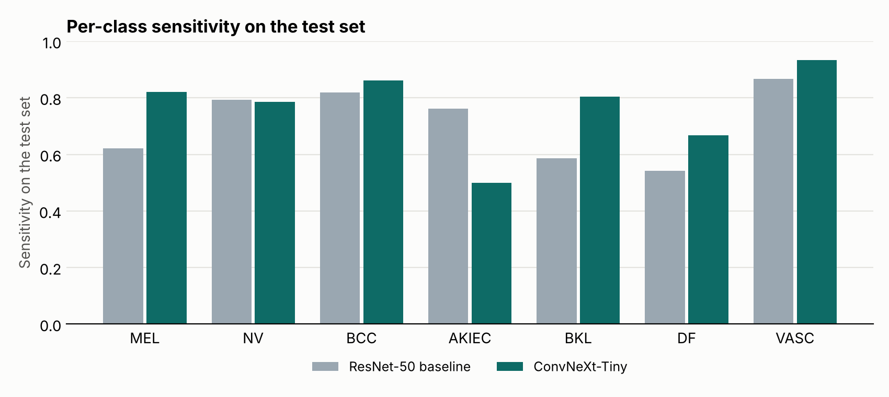
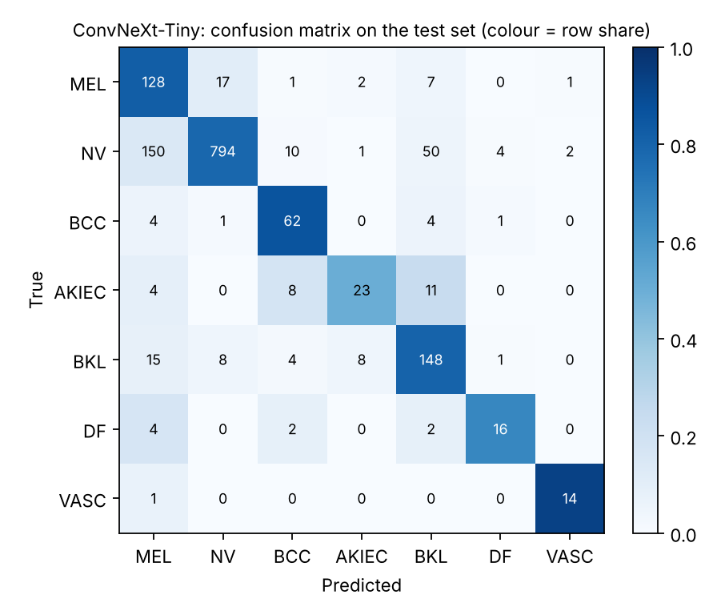
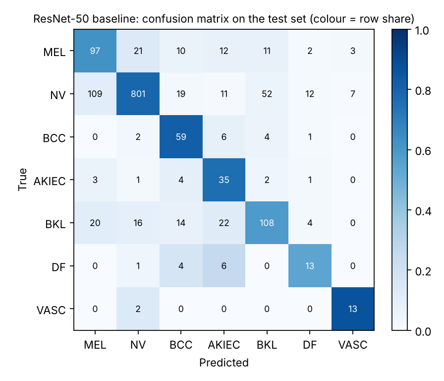
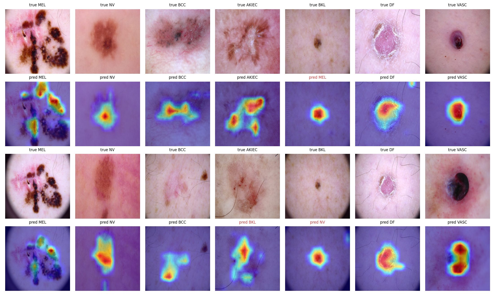

# Skin lesion classification on ISIC 2018

Seven-class classification of dermoscopic images (melanoma, nevus, basal cell carcinoma, actinic keratosis, benign keratosis, dermatofibroma, vascular lesion) on the ISIC 2018 Task 3 / HAM10000 dataset, with a web application (DermAssist) that turns the model into a triage tool.

This repository is a follow-up to my MSc capstone project. The capstone model (ResNet-50 with class-weighted loss) reached 76.7% accuracy but detected only 36% of melanomas and none of the dermatofibromas, and it was evaluated on the same image-level split that was used for model selection. Here I rebuilt the pipeline with a stricter evaluation and measured how much of that weakness can be fixed.

## What is different from the capstone

- **Leakage-free split.** HAM10000 contains several images of the same lesion, so the split is grouped by lesion id. No lesion appears in more than one of train / validation / test.
- **Separate test set.** Models are selected on the validation set only; the test set is predicted once.
- **Metric.** Balanced accuracy (mean per-class sensitivity), the official ISIC 2018 Task 3 metric, instead of plain accuracy.
- **Imbalance handling.** Class-balanced sampling and stronger augmentation instead of only a weighted loss.
- **Uncertainty.** 95% bootstrap confidence intervals on the test metrics.
- **Melanoma screening view.** A threshold on P(melanoma) is fixed on the validation set for 90% sensitivity and then reported on the test set.
- **Class-specific Grad-CAM**, computed for the predicted class.

## Results

<!-- RESULTS:START -->
| Model | Accuracy | Balanced accuracy | Macro-F1 | Macro-AUC | Melanoma sensitivity | DF sensitivity |
|---|---|---|---|---|---|---|
| ResNet-50 baseline (224 px) | 0.747 (0.724-0.769) | 0.713 (0.664-0.756) | 0.609 | 0.932 (0.919-0.944) | 0.622 (0.546-0.692) | 0.542 |
| ConvNeXt-Tiny (384 px) | 0.786 (0.766-0.808) | 0.767 (0.722-0.809) | 0.725 | 0.966 (0.957-0.974) | 0.821 (0.761-0.877) | 0.667 |

Test set: 1,508 images, a held-out split grouped by lesion. Brackets are 95% bootstrap intervals (1,000 resamples).

Melanoma screening view (flag when P(MEL) is above a threshold fixed on the validation set):

| Model | Threshold | Test sensitivity | Test specificity | Melanoma AUC |
|---|---|---|---|---|
| ResNet-50 baseline | 0.067 | 0.910 (0.864-0.952) | 0.636 | 0.869 |
| ConvNeXt-Tiny | 0.217 | 0.942 (0.904-0.975) | 0.755 | 0.933 |
<!-- RESULTS:END -->

### Findings

- **ConvNeXt is better on every summary metric.** Macro AUC rose from 0.932 to 0.966 with non-overlapping intervals. Balanced accuracy rose from 71.3% to 76.7%, but those intervals overlap, so the size of that gain is less certain.
- **Melanoma detection improved the most.** As the top prediction, melanoma sensitivity rose from 62.2% to 82.1%. With the validation-tuned threshold the model flags 94.2% of test melanomas at 75.5% specificity.
- **The cost is false alarms on nevi.** 150 of 1,011 nevi are predicted as melanoma, the main error in the confusion matrix.
- **Actinic keratosis got worse** (76.1% to 50.0% sensitivity, 46 test images), mostly confused with benign keratosis and basal cell carcinoma. Balanced sampling did not help this class.
- **The validation curve peaks early** (epoch 4 of 25) and then fluctuates, so results from a single seed should be read with care.



| ConvNeXt-Tiny | ResNet-50 baseline |
|---|---|
|  |  |



*Grad-CAM for the predicted class on two test images per class; titles in red are errors.*

## Training and evaluation

```bash
pip install -r requirements.txt
bash run_all.sh
```

`run_all.sh` uses the HAM10000 dataset if it is already available (on Kaggle: the *Skin Cancer MNIST: HAM10000* dataset as input), otherwise downloads it from the ISIC challenge bucket. It then builds the split, trains both models, evaluates them and writes everything to `results/`. `notebooks/experiments.ipynb` runs the same steps on a single T4 GPU (about an hour of training for both models).

## DermAssist web application

`app/` is a FastAPI application with four pages:

- **Research**: the results above, with confidence-interval plots, per-class table, figures and limitations.
- **Analyse**: upload a dermoscopic image and get
  - the probability of all seven classes and a refer / routine suggestion,
  - the melanoma probability against the screening threshold,
  - Grad-CAM for each of the three most likely classes, blended over the image with a slider,
  - an ABCDE checklist: asymmetry, border and colour measured from the image, diameter and evolution entered by the clinician,
  - the most similar training cases (nearest neighbours in the model's feature space),
  - information about the predicted condition with links to Google, YouTube, Wikipedia and Google Scholar,
  - booking an appointment or sending the case to the review queue.
- **Hospital**: an example integration at a fictional district hospital in Nepal, with the referral pathway, clinic schedule and a dermatologist review queue.
- **Appointments**: book the visiting dermatologist, linked to an analysed case.

Cases and bookings are stored in `app/data/` on the machine running the app. The hospital is fictional and no real appointments are made.

### Running it

1. Install the requirements (Python 3.10 or newer):
   ```bash
   python -m venv venv
   venv\Scripts\activate          # Windows; on macOS/Linux: source venv/bin/activate
   pip install -r app/requirements.txt
   ```
2. Put the trained checkpoint at `checkpoints/convnext_balanced.pth`.
3. Optional: put the similar-case gallery in `app/gallery/` (built by `src/build_gallery.py`).
4. Start the server from the repository root and open http://localhost:8000:
   ```bash
   uvicorn app.server:app --port 8000
   ```

Without a checkpoint the Research, Hospital and Appointments pages still work, and the Analyse page explains that the model is not loaded.

## Layout

```
src/download_data.py   download ISIC 2018 Task 3 (if not already available)
src/splits.py          lesion-grouped train / val / test split
src/data.py            dataset and augmentation
src/train.py           training (timm models, AMP, cosine schedule)
src/evaluate.py        metrics, bootstrap CIs, melanoma operating point
src/make_report.py     results table and per-class figure
src/gradcam.py         class-specific Grad-CAM grid
src/build_gallery.py   embeddings and thumbnails for the similar-case search
app/                   DermAssist web application (FastAPI + HTML/CSS/JS)
results/               metrics, figures and the exact split used
```

## Limitations

- One public dataset, mostly from European clinics and lighter skin types; performance on patients in Nepal is unknown.
- The test set is a held-out split of the same dataset, not an external or prospective study.
- Dermatofibroma and vascular lesions have only 24 and 15 test images.
- Single training run per model.
- The ABCDE measurements use simple image processing and illustrative cut-offs; they are not validated.

## Data and references

ISIC 2018 Task 3 training set, which is the HAM10000 dataset: 10,015 dermoscopic images with lesion ids, licensed CC BY-NC 4.0. The images are not included in this repository.

- N. Codella et al. "Skin Lesion Analysis Toward Melanoma Detection 2018: A Challenge Hosted by the International Skin Imaging Collaboration (ISIC)." arXiv:1902.03368, 2019.
- P. Tschandl, C. Rosendahl, H. Kittler. "The HAM10000 dataset, a large collection of multi-source dermatoscopic images of common pigmented skin lesions." Scientific Data 5, 180161, 2018.
- Z. Liu et al. "A ConvNet for the 2020s." CVPR, 2022.
- R. R. Selvaraju et al. "Grad-CAM: Visual Explanations from Deep Networks via Gradient-based Localization." ICCV, 2017.

This is a research project and is not a medical device.
